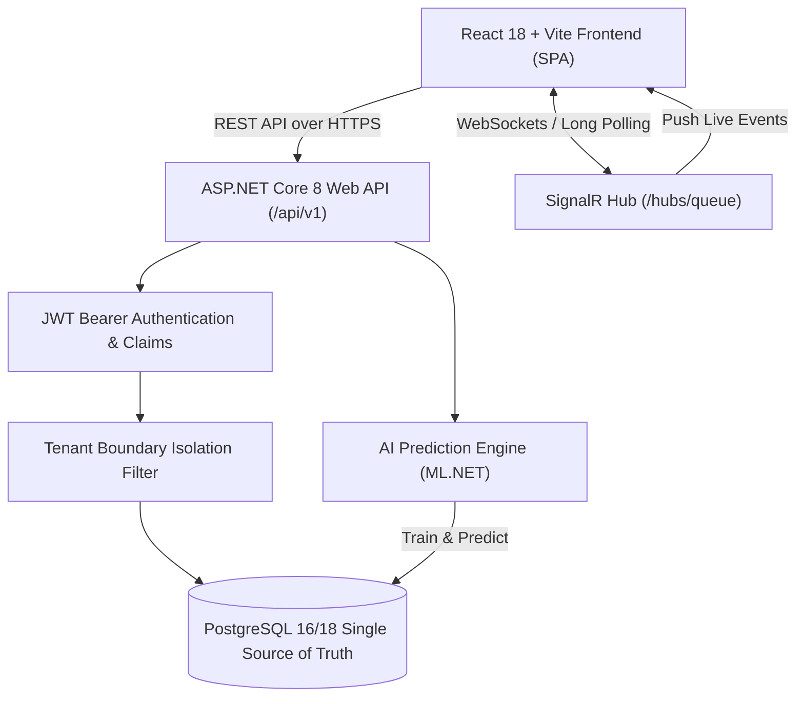
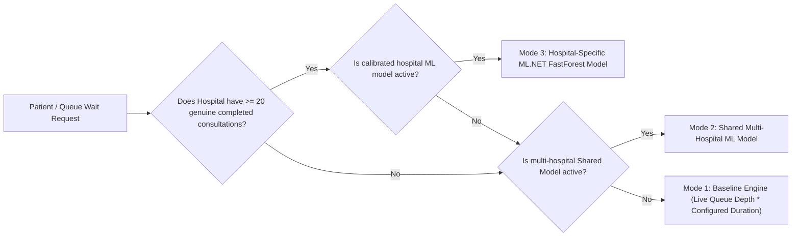

# QueueLess Architecture Documentation

## 1. System Overview

QueueLess is an enterprise multi-hospital queue management platform featuring an integrated AI-assisted waiting-time prediction engine. The system is designed from the ground up as a multi-tenant healthcare solution where independent hospitals manage their clinical departments, doctors, schedules, and active consultation queues, while patients utilize a single unified account to discover hospitals and book queue tokens.

---

## 2. Multi-Tenant Architecture

Each hospital operates as an isolated tenant within QueueLess:

1. **UUID Primary Keys**: Every entity is identified by a unique GUID/UUID.
2. **Hospital Ownership (`HospitalId`)**: All hospital-owned entities (`Departments`, `Doctors`, `DoctorDepartments`, `DoctorSchedules`, `QueueSessions`, `Bookings`, `ConsultationRecords`, `MLModelVersions`) carry a foreign key constraint to `Hospitals.Id`.
3. **Claims-Derived Authorization**: Authorization does not trust client-supplied `HospitalId` parameters. Instead, tenant context is derived from the authenticated user's `HospitalMember` record.
4. **Cross-Tenant Prevention**: Hospital A administrators or queue operators cannot query, call, start, or modify records belonging to Hospital B. Queries enforce strict `HospitalId` filters.
5. **Universal Patient Identity**: Patients hold a single global account and may book queue tokens across multiple independent hospitals simultaneously without becoming members of any hospital.

---

## 3. Real-Time Communication Architecture

Queue updates and token calls are distributed instantly via ASP.NET Core SignalR:

- **Hub Route**: `/hubs/queue`
- **Group Scoping**:
  - `QueueSession_{sessionId}`: Broadcasts `TokenCalled`, `ConsultationStarted`, `ConsultationCompleted`, `QueueUpdated`. Connected patient and doctor dashboards update instantaneously.
  - `Patient_{userId}`: Delivers private in-app notifications directly to the specific patient (e.g., token called alerts, cancellation confirmations).
- **Authoritative Fallback**: Clients re-fetch authoritative state from the REST API on WebSocket reconnection.

---

## 4. 3-Tier AI Waiting-Time Prediction Pipeline

- **Mode 1 (Baseline)**: For newly registered hospitals with zero consultation history. Calculates expected wait dynamically from people ahead in queue and department consultation duration.
- **Mode 2 (Shared Model)**: Multi-hospital regression model trained on de-identified consultation patterns across participating hospitals.
- **Mode 3 (Hospital-Specific Model)**: Calibrated directly on that hospital's genuine completed consultation records, evaluated against baseline MAE.
- **Graceful Fallback**: If an ML model is unavailable or evaluates poorly, the engine seamlessly falls back to Mode 1 baseline calculation without disrupting clinical operations.
