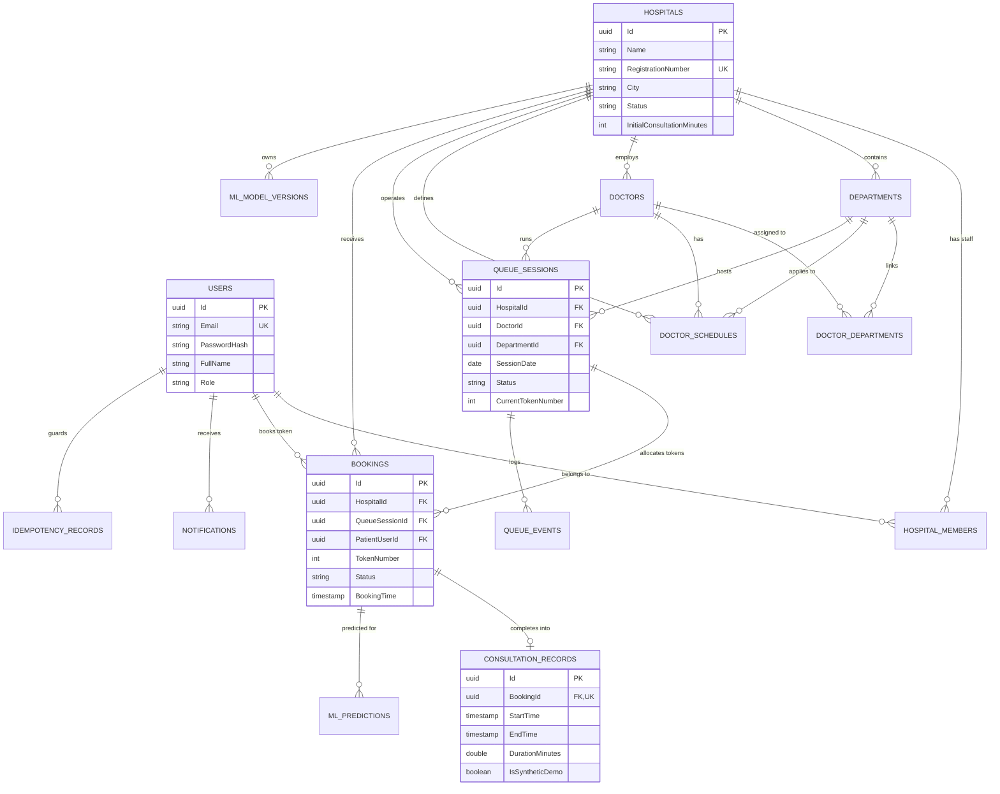

# QueueLess Database Design & Entity Relationships

PostgreSQL is the single persistent source of truth for QueueLess. The database is managed via Entity Framework Core migrations with PostgreSQL-native types, indexes, and constraints.

---

## 1. Entity Relationship Diagram (ERD)

---

## 2. Table Specifications (16 Entities)

### 1. `Users`
- Stores all platform actors: Patients, Hospital Administrators, Doctors, and Platform Administrators.
- Unique index on `Email`.

### 2. `Hospitals`
- Stores hospital tenant profiles.
- Unique index on `RegistrationNumber`.
- Indexed on `City` and `Status` (`PENDING`, `APPROVED`, `REJECTED`, `SUSPENDED`).
- Stores `InitialConsultationMinutes` (baseline duration for new hospitals).

### 3. `HospitalMembers`
- Maps users to hospital administrative or operational roles (`Admin`, `Operator`, `Doctor`).
- Composite unique index on `(HospitalId, UserId)`.

### 4. `Departments`
- Hospital clinical departments (e.g., Cardiology, Pediatrics, General Medicine).
- Stores `DefaultConsultationMinutes` (configurable department baseline).
- Composite index on `(HospitalId, Name)`.

### 5. `Doctors`
- Licensed physicians associated with a hospital. Optional link to `Users` for login credentials.
- License number and medical specialization.

### 6. `DoctorDepartments`
- Many-to-many junction table between doctors and clinical departments.
- Composite unique index on `(DoctorId, DepartmentId)`.

### 7. `DoctorSchedules`
- Weekly availability schedules (`DayOfWeek`, `StartTime`, `EndTime`, `SlotDurationMinutes`, `MaxPatientsPerSession`).

### 8. `QueueSessions`
- Live daily queues scoped to doctor, department, and hospital.
- Atomic token counter `CurrentTokenNumber`.
- Status: `SCHEDULED`, `OPEN`, `PAUSED`, `CLOSED`.
- Tracks `CurrentServingBookingId`.

### 9. `Bookings`
- Individual patient queue token allocations.
- Unique composite constraint on `(QueueSessionId, TokenNumber)`.
- Status: `WAITING`, `CALLED`, `SERVING`, `COMPLETED`, `CANCELLED`, `NO_SHOW`.
- Indexed on `Status`, `PatientUserId`, and `IdempotencyKey`.

### 10. `QueueEvents`
- Chronological audit trail for queue operations (`CREATED`, `CALLED`, `STARTED`, `COMPLETED`, `NO_SHOW`, `PAUSED`, `RESUMED`, `CANCELLED`).

### 11. `ConsultationRecords`
- Recorded on consultation completion.
- Stores `StartTime`, `EndTime`, `DurationSeconds`, `DurationMinutes`.
- Flags `IsSyntheticDemo` (true for test datasets, false for genuine clinical encounters).
- Single source of truth for AI model training pipelines.

### 12. `Notifications`
- Database-backed in-app patient notifications.
- Tracks `IsRead` state and related entity IDs.

### 13. `AuditLogs`
- Administrative audit logs with IP address and action metadata.

### 14. `MLModelVersions`
- Versioned ML.NET regression models (`SHARED` or `HOSPITAL_SPECIFIC`).
- Tracks file path, training record count, `MeanAbsoluteError`, `BaselineMAE`, and `IsActive` state.

### 15. `MLPredictions`
- Audit trail for waiting-time predictions.
- Stores `PredictionMethod` (`BASELINE`, `SHARED_MODEL`, `HOSPITAL_MODEL`), feature snapshot JSON, predicted minutes, and baseline comparison.

### 16. `IdempotencyRecords`
- Prevents duplicate booking token allocations on network retries.
- Keyed by client request idempotency token with 24-hour expiration window.
