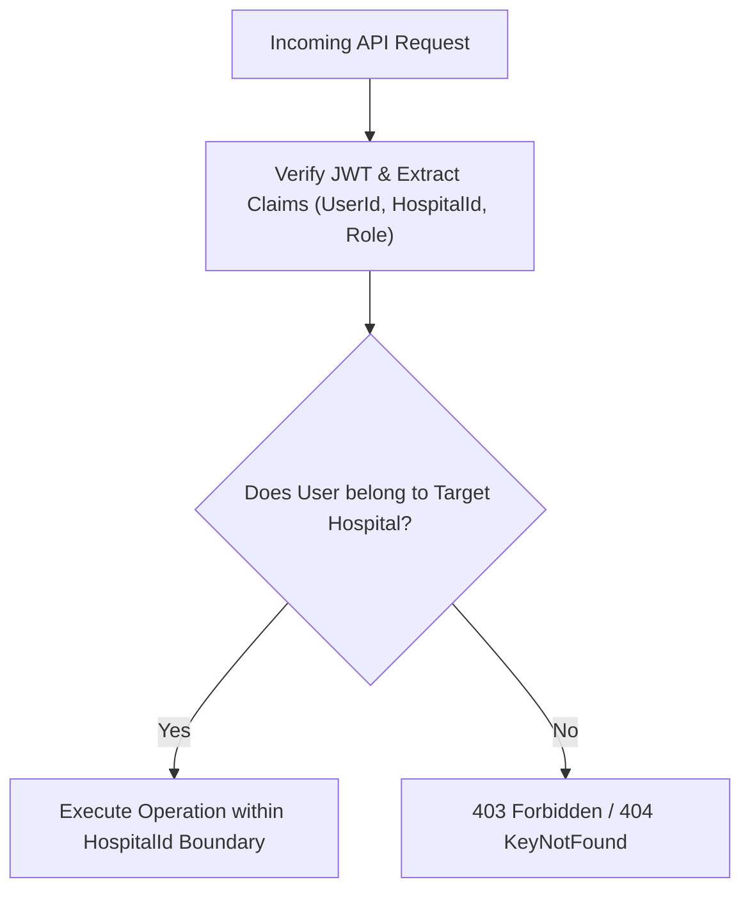

# QueueLess Security & Tenant Isolation Architecture

## 1. Authentication & Credentials

1. **Password Hashing**: Uses BCrypt (`workFactor: 11`). Passwords are never stored in plaintext.
2. **JWT Bearer Authentication**: Signed using HMAC-SHA256 with minimum 256-bit secret keys.
3. **Token Expiry**: Configurable expiration (default: 120 minutes) with clock skew zero.
4. **Environment Isolation**: Secrets, JWT keys, and database passwords are loaded from environment variables (`.env`) and never committed into Git repositories.

---

## 2. Multi-Tenant Boundary Enforcement

1. **Tenant Identity Resolution**: The backend never trusts a `HospitalId` supplied by the frontend payload as proof of authorization. Hospital membership is verified via `HospitalMembers` and JWT claims.
2. **Foreign Key Integrity**: Cross-hospital relationship assignments (e.g., assigning Doctor from Hospital B to Department in Hospital A) are rejected at the database and service layer.
3. **Patient Data Confidentiality**: Patients can only inspect their own booking records. A patient cannot query or subscribe to another patient's private consultation details.

---

## 3. Idempotency & Concurrency Safety

1. **Atomic Token Allocation**: Token numbers are incremented within an atomic database transaction scoped to `QueueSessionId`.
2. **Unique Composite Constraint**: A database-level unique constraint on `(QueueSessionId, TokenNumber)` prevents duplicate tokens even under concurrent requests.
3. **Idempotency Keys**: Patient booking requests accept an optional `IdempotencyKey`. If a duplicate request arrives (due to network retries), the cached response is returned without creating duplicate tokens or exceeding session capacity.
4. **Capacity Protection**: Active bookings count is checked inside the transaction before token issuance.

---

## 4. SignalR Security

1. **WebSocket Authentication**: SignalR clients authenticate via JWT bearer token passed in query parameters (`/hubs/queue?access_token=...`).
2. **Group Partitioning**: Clients only receive events for sessions they explicitly joined (`QueueSession_{id}`) or their own private user channel (`Patient_{userId}`).
